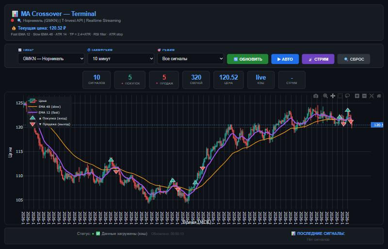
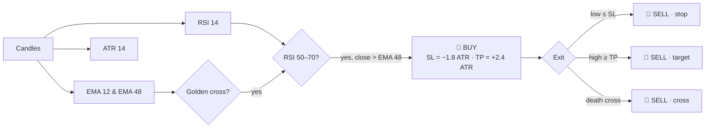

<h1 align="center">📊 MA Crossover Terminal</h1>

<p align="center">
  <b>A modular Python trading terminal for the Russian stock market.</b><br>
  Live T-Invest market data, interactive candlestick charts, EMA-crossover signals with RSI and ATR filters, and an offline backtester.
</p>

<p align="center">
  
  
  
  
  
  
  
</p>

<p align="center">
  
  <br><sub>The terminal UI with EMA 12 / EMA 48, buy and sell markers and live counters. Screenshot on synthetic demo data.</sub>
</p>

> [!IMPORTANT]
> **For education and research only.** This is not financial advice and does not guarantee returns.
> The terminal shows data and generates signals; **it never sends trading orders**.

---

## ✨ Features

| | |
|---|---|
| 📡 **Market data** | Candles and instruments from the T-Invest API: 46 IMOEX stocks, timeframes from 1 minute to 1 month. |
| ⚡ **Real-time stream** | Live candles from the broker stream, pushed to the browser over WebSocket. |
| 📈 **Interactive charts** | Plotly candlesticks with fast and slow EMA, buy/sell markers, zoom and pan. |
| 🧠 **Strategy** | EMA 12 / 48 golden cross, confirmed by RSI 50–70 and price above the slow EMA. |
| 🛡️ **Risk levels** | ATR-based stop-loss (1.8 × ATR) and take-profit (2.4 × ATR); the stop is checked first on the same bar. |
| 🔁 **Two modes** | *All signals* or *Trading*: only signals that become actual trades. |
| 🧪 **Backtesting** | Run the strategy on any OHLCV CSV with commission and slippage, compared with buy-and-hold. |
| 🧩 **Modular** | Strategy, market data, streaming, caching, charts and web server are separate modules. |

---

## 🚀 Getting started

**Requirements:** Python 3.11+, a T-Invest API token (read-only is enough) and internet access.

```bash
git clone https://github.com/the-volador42/ma-crossover-terminal.git
cd ma-crossover-terminal
py -3.11 -m venv .venv
.venv\Scripts\activate
python -m pip install --upgrade pip
python -m pip install -r requirements.txt
```

### Configuration

Copy `.env.example` to `.env` and fill in your token:

```dotenv
INVEST_TOKEN=your_t_invest_api_token
DEFAULT_SYMBOL=GMKN
HTTP_PORT=8080
WS_PORT=8765
COMMISSION_PER_SIDE_PCT=0.05
SLIPPAGE_PER_SIDE_PCT=0.02
```

> [!CAUTION]
> Never commit `.env` or share your token. `.env` is already in `.gitignore`.

### Run

```bat
set "PYTHONPATH=%CD%\src"
python -m ma_terminal.main
```

The browser opens **http://127.0.0.1:8080** automatically. The WebSocket stream runs on `ws://127.0.0.1:8765`.

---

## 🧠 Strategy



All parameters live in [`config.py`](src/ma_terminal/config.py). They are assumptions to test, not a promise of profit.

---

## 🧪 Backtesting

Run the strategy offline on an OHLCV CSV (`Date, Open, High, Low, Close[, Volume]`):

```bat
set "PYTHONPATH=%CD%\src"
python -m ma_terminal.backtest path\to\data.csv --show-trades
```

You get the number of trades, win rate, net compound PnL after costs, profit factor and buy-and-hold over the same period.
The strategy needs at least ~50 bars before the first signal; [`examples/sample_ohlcv.csv`](examples/sample_ohlcv.csv) only shows the file format.

> Results depend on the instrument, period, costs, slippage and market conditions. Past performance does not guarantee future results.

---

## ✅ Tests

```bash
python -m unittest discover -s tests -v
```

---

## 🧩 Project structure

```text
src/ma_terminal/
├── main.py          # entry point: starts workers and servers
├── config.py        # settings, tickers, strategy parameters
├── strategy.py      # EMA, RSI, ATR, signals, trades and statistics
├── market_data.py   # T-Invest SDK adapter: instruments and candles
├── streaming.py     # broker stream + WebSocket server
├── services.py      # cache, signal notifications, broadcasts
├── charts.py        # chart payloads for the UI
├── web_server.py    # HTTP API and static UI
├── backtest.py      # offline CSV backtest
├── state.py         # shared state and locks
└── web/             # HTML template, CSS, JS
```

---

## 🔒 Security

- Servers bind to `127.0.0.1` only. Don't expose them without authentication.
- Never commit `.env`, broker tokens, cookies or account identifiers.
- See [SECURITY.md](SECURITY.md).

## 📄 License

[MIT](LICENSE)
